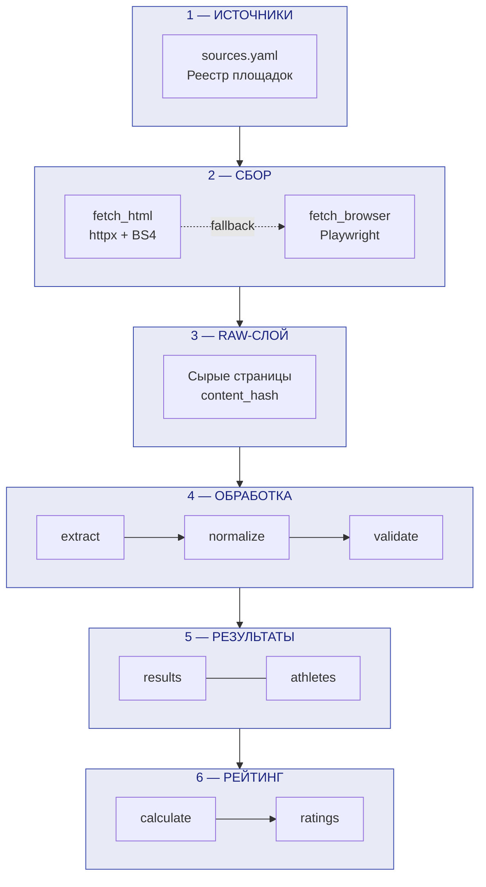
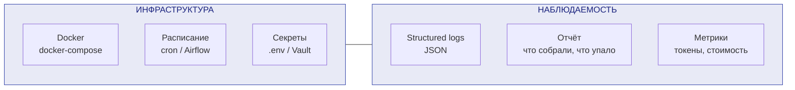
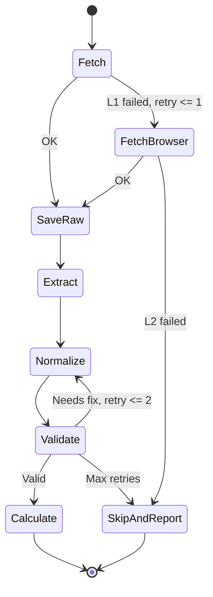
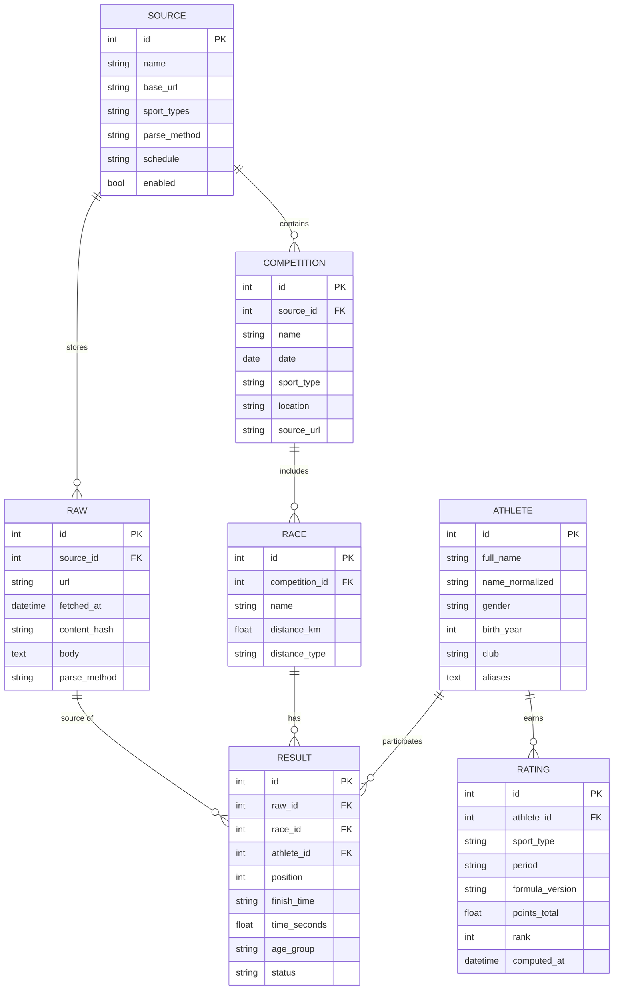
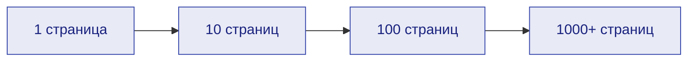

# Архитектура агента для сбора спортивных результатов

| | |
|---|---|
| **Проект** | Агент для сбора информации о спортивных достижениях |
| **Заказчик** | ПАО Сбербанк |
| **Куратор** | Ушенин К.С. |
| **Роль** | Инфраструктура |
| **Автор** | Титов Артём |
| **Статус** | Черновик |

---

## 1. Цель и задание

Моя задача — **спроектировать архитектуру агента**. Прототип кодить не нужно: нужен документ, который отвечает на вопросы:

- Из каких компонентов состоит система и как они связаны.
- Как данные идут от площадок до рейтинга.
- На чём всё запускается и где хранится.
- Как масштабировать: 1, 10, 100, 1000 страниц.
- Какие риски и как контролировать стоимость токенов.

**Цепочка продукта:**

```mermaid
flowchart LR
    A["Источники"] --> B["Сбор"]
    B --> C["Raw-слой"]
    C --> D["Нормализация"]
    D --> E["Валидация"]
    E --> F["Расчёт баллов"]
    F --> G["Рейтинг"]

    style A fill:#e8eaf6,stroke:#3949ab,color:#1a237e
    style B fill:#e8eaf6,stroke:#3949ab,color:#1a237e
    style C fill:#e8eaf6,stroke:#3949ab,color:#1a237e
    style D fill:#e8eaf6,stroke:#3949ab,color:#1a237e
    style E fill:#e8eaf6,stroke:#3949ab,color:#1a237e
    style F fill:#e8eaf6,stroke:#3949ab,color:#1a237e
    style G fill:#e8eaf6,stroke:#3949ab,color:#1a237e
```



**Критерий оценки:** результаты собираются с площадок из списка, приводятся к единой схеме, рейтинг считается по текущим формулам бега, трейлов и лыж.

---

## 2. Принципы, заданные куратором

1. В команде никто раньше не создавал агентов — берём **простой стек**: LangGraph в минимальном виде либо просто набор скиллов (парсинг страницы, извлечение форм в таблицу).
2. **Токены дорогие** — LLM используем только там, где без неё нельзя; парсинг по возможности делаем обычным кодом.
3. **Сначала проектируем таблицы данных**, потом собираем данные.
4. **Масштабируем постепенно**: одна страница, затем 10, 100, 1000; на каждом шаге добиваемся результата.
5. **Парсинг двух типов**: статический HTML (Beautiful Soup) и через браузер (Playwright). Первый быстрее и проще, второй — запасной путь для сложных страниц.

---

## 3. Архитектура по слоям

### 3.1 Общая схема — пайплайн данных



### 3.1.1 Инфраструктура и наблюдаемость

Поперечные слои, которые обслуживают весь пайплайн:



Данные идут сверху вниз по пайплайну. Оркестратор запускает каждый шаг, повторяет сбои (с лимитом) и пишет логи. Инфраструктура и наблюдаемость — сквозные слои, обслуживающие все этапы.

---

### 3.2 Реестр источников

Конфиг (YAML или таблица в БД): площадка, URL, вид спорта, тип парсинга (`html` или `browser`), расписание, статус. Новая площадка добавляется строкой в реестре, а не новым кодом.

```yaml
# config/sources.yaml
# Конкретные площадки — из списка заказчика.
# Ниже — примеры формата; реальные URL заполняются после получения списка.
sources:
  - name: "Площадка A (пример)"
    base_url: "https://example-running.com"
    sport_types: [running, trail]
    parse_method: html
    schedule: "daily"
    enabled: true

  - name: "Площадка B (пример)"
    base_url: "https://example-ski.com"
    sport_types: [skiing]
    parse_method: html
    schedule: "weekly"
    enabled: true

  - name: "Площадка C (пример, SPA)"
    base_url: "https://example-results.com"
    sport_types: [running, triathlon]
    parse_method: browser
    schedule: "daily"
    enabled: false
```

> [!IMPORTANT]
> Площадки из примеров — условные. Реальный список предоставляет заказчик. Формат конфига одинаковый для любых площадок.

---

### 3.3 Сбор (коллекторы / скиллы)

**Два уровня парсинга:**

| Уровень | Технология | Когда использовать | Характеристика |
|:--------|:-----------|:-------------------|:---------------|
| L1 — HTML | `httpx` + `BeautifulSoup` | Статичные страницы, таблицы без JS | Быстро, дёшево |
| L2 — Браузер | `Playwright` | Страницы с JS-рендерингом | Медленнее; при сбоях нужны скриншоты |

**Скиллы:**

| Скилл | Вход | Выход | Описание |
|:------|:-----|:------|:---------|
| `fetch_html` | URL | Raw HTML | Скачивание страницы через httpx |
| `fetch_browser` | URL | Raw HTML | Скачивание через Playwright (fallback) |
| `extract_table` | Raw HTML, вид спорта | Сырая таблица | Извлечение протокола из HTML |

> [!WARNING]
> Playwright **не решает капчу**. Если площадка ставит капчу — пропустить и записать в отчёт.
> Перед парсингом проверять **robots.txt** и соблюдать **rate limits** (задержки между запросами).

**Raw-слой.** Сырые страницы всегда сохраняются с хэшем содержимого:
- Перепарсить без повторной загрузки (экономия токенов и трафика).
- Не создавать дубли при повторном запуске (проверка по `content_hash`).
- Отлаживать парсеры на реальных данных.

```python
async def fetch_and_store(url: str, method: str = "html") -> RawPage:
    existing = db.query(Raw).filter_by(url=url).first()
    if existing and not is_stale(existing):
        return existing

    if method == "html":
        html = await fetch_html(url)
    else:
        html = await fetch_browser(url)

    raw = Raw(
        url=url,
        body=html,
        content_hash=hashlib.sha256(html.encode()).hexdigest(),
        fetched_at=datetime.utcnow(),
        parse_method=method,
    )
    db.add(raw)
    return raw
```

---

### 3.4 Нормализация

Приведение к единой схеме: ФИО, пол, возрастная группа, дата, старт, дистанция, время или место, статус (DNF, DSQ), вид спорта.

LLM подключается точечно: если парсер не распознал формат новой площадки, агент предлагает правило разбора, а дальше работает обычный код. Найденные правила кешируются, чтобы не тратить токены повторно.

---

### 3.5 Движок рейтинга

Формулы по видам спорта (бег, трейлы, лыжи; позже биатлон и триатлон) оформляются как отдельные модули с тестами.

> [!IMPORTANT]
> LLM здесь **не используется**: результат должен быть детерминированным и проверяемым. Формула выбирается по полю `sport_type`.

```python
FORMULAS = {
    "running": RunningFormula(),
    "trail":   TrailFormula(),
    "skiing":  SkiingFormula(),
}

def calculate_rating(results: list[NormalizedResult], sport: str) -> list[Rating]:
    formula = FORMULAS[sport]
    return [formula.calculate(r) for r in results]
```

---

### 3.6 Оркестратор агента (LangGraph)

Порядок шагов фиксированный — LLM-планировщик не нужен, токены на «планирование» не тратим.



**Ограничения циклов:**

| Переход | Максимум повторов | При превышении |
|:--------|:-----------------:|:---------------|
| Validate — Normalize | 2 | Пропустить, записать в отчёт |
| Fetch — FetchBrowser | 1 | Пропустить, записать в отчёт |

```python
from langgraph.graph import StateGraph, END

class AgentState(TypedDict):
    source_url: str
    sport_type: str
    raw_page: RawPage | None
    parsed_results: list[dict]
    normalized_results: list[NormalizedResult]
    ratings: list[Rating]
    errors: list[str]
    retry_count: int
    parse_retry_count: int

MAX_NORMALIZE_RETRIES = 2
MAX_PARSE_RETRIES = 1

def route_after_validate(state: AgentState) -> str:
    if state["errors"] and state["retry_count"] < MAX_NORMALIZE_RETRIES:
        return "normalize"
    elif state["errors"]:
        return "skip_report"
    else:
        return "calculate"

def route_after_fetch(state: AgentState) -> str:
    if state["raw_page"] is None and state["parse_retry_count"] < MAX_PARSE_RETRIES:
        return "fetch_browser"
    elif state["raw_page"] is None:
        return "skip_report"
    else:
        return "save_raw"

graph = StateGraph(AgentState)
graph.add_node("fetch", fetch_html_skill)
graph.add_node("fetch_browser", fetch_browser_skill)
graph.add_node("save_raw", save_raw_skill)
graph.add_node("extract", extract_table_skill)
graph.add_node("normalize", normalize_skill)
graph.add_node("validate", validate_skill)
graph.add_node("calculate", calculate_rating_skill)
graph.add_node("skip_report", skip_and_report_skill)

graph.add_conditional_edges("fetch", route_after_fetch)
graph.add_edge("fetch_browser", "save_raw")
graph.add_edge("save_raw", "extract")
graph.add_edge("extract", "normalize")
graph.add_edge("normalize", "validate")
graph.add_conditional_edges("validate", route_after_validate)
graph.add_edge("calculate", END)
graph.add_edge("skip_report", END)

graph.set_entry_point("fetch")
agent = graph.compile()
```

> [!TIP]
> Основа — скиллы. LangGraph кладём сверху в минимальном виде: если фреймворк не пойдёт, скиллы работают и без него (через cron или скрипт).

---

## 4. Схема данных

### 4.1 ER-диаграмма



### 4.2 Ключевые решения по модели данных

| Решение | Обоснование |
|:--------|:------------|
| Отдельная сущность `RACE` | На одном старте бывает несколько дистанций (марафон + 10 км + 5 км). `distance_km` как число удобно для формул |
| `birth_year` вместо `birth_date` | В протоколах почти никогда нет полной даты рождения, обычно только год |
| `name_normalized` + `aliases` | Один спортсмен может быть записан по-разному на разных площадках. Дедупликация — главный риск |
| `period` в `RATING` | Рейтинг считается за период (квартал, сезон, год), а не «навсегда» |
| `formula_version` | Позволяет пересчитать рейтинг при изменении формул и сохранить прежние значения |
| `content_hash` в `RAW` | Не создавать дубли при повторном запуске; определять, изменилась ли страница |

### 4.3 Дедупликация спортсменов

Это главный риск модели данных. Один человек на разных площадках может быть записан как «Иванов Иван», «Иванов И.И.», «Ivan Ivanov» — с разным клубом или без него.

**Стратегия:**

1. Нормализация имени: убрать лишние пробелы, привести регистр, транслитерация.
2. Нечёткое сравнение: расстояние Левенштейна + совпадение года рождения + пол.
3. Ручная проверка неоднозначных случаев (отчёт для оператора).
4. Таблица `aliases` для хранения всех встреченных написаний.

---

## 5. Инфраструктура

> [!IMPORTANT]
> Это основная зона ответственности роли «инфраструктура» — раздел, по которому будут оценивать.

### 5.1 Запуск и окружение

```yaml
# docker-compose.yaml (упрощённо)
services:
  agent:
    build: .
    env_file: .env
    depends_on: [db]
    volumes:
      - ./config:/app/config
      - ./logs:/app/logs
      - ./raw_cache:/app/raw_cache

  db:
    image: postgres:16
    volumes:
      - pgdata:/var/lib/postgresql/data
    environment:
      POSTGRES_DB: sports_agent
      POSTGRES_USER: agent
      POSTGRES_PASSWORD_FILE: /run/secrets/db_password

volumes:
  pgdata:
```

| Компонент | Где работает | Заметки |
|:----------|:-------------|:--------|
| Агент (Python) | Docker-контейнер | Одинаковое окружение у всей команды |
| PostgreSQL | Docker-контейнер; в проде — managed DB | SQLite для первых тестов |
| Raw-хранилище | Volume или S3-совместимое хранилище | Для больших объёмов вынести из БД |

> [!NOTE]
> Вопрос к заказчику: где должно работать решение — локально, на сервере или в облаке Сбера? Это влияет на выбор между Docker и Kubernetes и на доступ к LLM.

### 5.2 Расписание

Для MVP — cron внутри контейнера или хост-системы. Для прода — встроенный scheduler или Airflow.

```
# Примерный crontab
0 3 * * *   cd /app && python -m src.run_agent --mode=collect
0 6 * * *   cd /app && python -m src.run_agent --mode=calculate
0 9 * * 1   cd /app && python -m src.run_agent --mode=report
```

### 5.3 Секреты

| Секрет | Хранение (dev) | Хранение (prod) |
|:-------|:---------------|:----------------|
| API-ключи LLM | `.env` | Vault / K8s Secrets |
| Пароль БД | `.env` | Docker Secrets |
| Токены площадок | `.env` | Vault |

```env
# .env.example (не коммитить реальные значения)
LLM_API_KEY=sk-...
LLM_PROVIDER=openai
LLM_MODEL=gpt-4o-mini
DATABASE_URL=postgresql://agent:***@db:5432/sports_agent
MAX_REQUESTS_PER_MINUTE=10
```

### 5.4 Логи и мониторинг

Каждый запуск агента генерирует:

| Артефакт | Формат | Назначение |
|:---------|:-------|:-----------|
| Лог выполнения | JSON (structured logging) | Отладка, поиск ошибок |
| Отчёт о сборе | Таблица: площадка, собрано, ошибок, пропущено | Прогресс |
| Метрики токенов | Счётчик вызовов и токенов по моделям | Контроль стоимости |
| Метрики качества | Доля успешных парсингов, количество дублей | Оценка зрелости |

```python
import structlog
logger = structlog.get_logger()

logger.info("page_fetched", url=url, method="html", size_bytes=len(html))
logger.warning("parse_failed", url=url, error=str(e), retry=retry_count)
logger.info("run_complete",
    pages_total=100, pages_ok=93, pages_failed=7,
    tokens_used=12500, token_cost_usd=0.15,
)
```

**Пример отчёта после запуска:**

```
Отчёт сбора: 2026-10-15 03:00
---------------------------------------------------
Площадка A:  48/50 страниц OK   (2 ошибки: таймаут)
Площадка B:  30/30 страниц OK
Площадка C:   0/20 страниц FAIL (JS, нужен Playwright)
---------------------------------------------------
Итого:                78/100 (78%)
Новых результатов:    1 240
Дублей отсеяно:       38
Токенов LLM:          8 200 (~$0.10)
Подозрительных дедупликаций: 5 (требуют проверки)
```

### 5.5 Контроль стоимости токенов

| Мера | Описание |
|:-----|:---------|
| Кеш raw-слоя | Не скачивать повторно (проверка по `content_hash`) |
| Минимизация HTML | Чистить теги, стили, скрипты — передавать в LLM только текст таблиц |
| Кеш правил разбора | LLM один раз находит правило для формата, дальше работает код |
| Дешёвые модели | Для извлечения — мини-модели; тяжёлые — только для новых форматов |
| Лимит на запуск | Жёсткий бюджет токенов; при превышении — остановить и отчитаться |
| Мониторинг | Логировать каждый вызов LLM с количеством токенов |

---

## 6. Выбор технологий

| Задача | Выбор | Обоснование | Запасной вариант |
|:-------|:------|:------------|:-----------------|
| Оркестрация | LangGraph (минимальный) | Граф шагов с повторами и логами; рекомендован куратором | cron + скрипт, те же скиллы |
| Единица работы | Скиллы | Элементарные задачи; прототип за неделю | — |
| Парсинг L1 | httpx + BeautifulSoup | Быстро, дёшево, код пишется легко | — |
| Парсинг L2 | Playwright | Для JS-страниц; не решает капчу | Скриншоты при сбоях |
| LLM | Уточнить у заказчика | Политика банка: GigaChat, локальная модель или внешний API | Абстракция через `LLM_PROVIDER` |
| Хранилище | PostgreSQL | Связи, дедупликация | SQLite для прототипа |
| Запуск | Docker, docker-compose | Единое окружение | — |

> [!WARNING]
> LLM не выбран окончательно. GPT-4o, Gemini, GigaChat или локальная модель — зависит от политики заказчика и бюджета. Архитектура поддерживает замену провайдера через конфиг.

---

## 7. Персональные данные

> [!CAUTION]
> ФИО, год рождения и клуб спортсменов — персональные данные, подпадающие под 152-ФЗ «О персональных данных». Для заказчика уровня Сбербанка это критично.

Необходимо уточнить:
- Нужно ли согласие спортсменов на обработку, или данные считаются общедоступными (опубликованы на сайтах соревнований)?
- Какие требования к хранению и доступу?
- Нужна ли анонимизация для каких-то сценариев?

Вопрос вынесен в открытые (раздел 10).

---

## 8. Стратегия масштабирования



| Этап | Объём | Фокус | Ожидаемые проблемы |
|:-----|:------|:------|:-------------------|
| MVP | 1 страница | Один источник, один вид спорта; проверка всей цепочки | Понять формат данных |
| Этап 2 | 10 страниц | 2-3 источника; различия форматов | Около 10% страниц сломают парсер |
| Этап 3 | 100 страниц | Все виды спорта; доля ошибок, дубли, стоимость LLM | Дедупликация, новые форматы |
| Этап 4 | 1000+ | Нагрузка, расписание, мониторинг | Rate limiting, объём raw-хранилища |

На каждом увеличении объёма в 10 раз ожидаем около 10% новых нестандартных случаев. Переход на следующий шаг — только после достижения результата на текущем.

---

## 9. Риски

| Риск | Вероятность | Влияние | Митигация |
|:-----|:----------:|:-------:|:----------|
| Высокая стоимость токенов LLM | Высокая | Высокое | Кеш, минимизация HTML, дешёвые модели, лимит бюджета |
| Разнообразие форматов площадок | Высокая | Среднее | Итеративное добавление парсеров, LLM-fallback |
| Дубли спортсменов между площадками | Высокая | Высокое | Нормализация имён, нечёткое сравнение, ручная проверка |
| Блокировки и rate limits площадок | Средняя | Среднее | robots.txt, задержки, кеш raw, User-Agent |
| Страницы на JavaScript (SPA) | Средняя | Среднее | Playwright как fallback |
| Персональные данные (152-ФЗ) | Средняя | Высокое | Уточнить правовой статус с заказчиком |
| Неизвестные формулы рейтинга | Средняя | Высокое | Запросить у заказчика до реализации |
| Нет опыта с агентскими фреймворками | Высокая | Среднее | Начать со скиллов без LangGraph, добавить позже |

---

## 10. Открытые вопросы к заказчику и куратору

| N | Вопрос | Адресат | Приоритет |
|:-:|:-------|:--------|:---------:|
| 1 | Есть ли готовый список площадок и сколько их? | Заказчик | Высокий |
| 2 | Какие текущие формулы рейтинга для бега, трейлов и лыж? | Заказчик | Высокий |
| 3 | Есть ли доступ к LLM? Какой провайдер и бюджет? (GigaChat, внешний API, локальная модель) | Куратор, заказчик | Высокий |
| 4 | Где должно работать решение: локально, на сервере или в облаке? | Заказчик | Средний |
| 5 | Как часто обновлять данные: разово или по расписанию? | Заказчик | Средний |
| 6 | Каков правовой статус персональных данных спортсменов? Нужно ли согласие? (152-ФЗ) | Заказчик | Средний |
| 7 | Есть ли требования к формату выдачи (CSV, дашборд, API)? | Заказчик | Низкий |

---

## 11. Структура проекта

```
sports-rating-agent/
├── docker-compose.yaml
├── Dockerfile
├── pyproject.toml
├── .env.example
├── config/
│   ├── sources.yaml
│   └── formulas.yaml
├── src/
│   ├── agent/
│   │   ├── graph.py
│   │   └── state.py
│   ├── skills/
│   │   ├── fetch_html.py
│   │   ├── fetch_browser.py
│   │   ├── extract_table.py
│   │   ├── normalize.py
│   │   ├── validate.py
│   │   └── calculate.py
│   ├── parsers/
│   │   ├── base.py
│   │   └── generic.py
│   ├── formulas/
│   │   ├── base.py
│   │   ├── running.py
│   │   ├── trail.py
│   │   └── skiing.py
│   ├── models/
│   │   ├── raw.py
│   │   ├── competition.py
│   │   ├── race.py
│   │   ├── result.py
│   │   ├── athlete.py
│   │   └── rating.py
│   ├── dedup/
│   │   └── athlete_matcher.py
│   ├── storage/
│   │   ├── database.py
│   │   └── cache.py
│   ├── monitoring/
│   │   ├── logger.py
│   │   ├── report.py
│   │   └── token_tracker.py
│   └── run_agent.py
├── tests/
│   ├── test_parsers/
│   ├── test_formulas/
│   ├── test_normalize/
│   └── test_dedup/
└── docs/
    └── architecture.md
```

*Документ подготовлен: Титов Артём, Инфраструктура*
