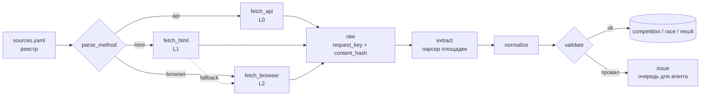
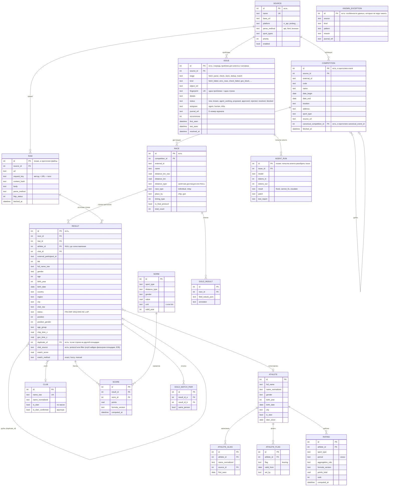

# Спецификация: парсер протоколов и база данных (бег)

| | |
|---|---|
| **Опирается на** | [architecture.md](../architecture.md), ТЗ заказчика от 2026-10-20 |
| **Прототип** | [running/](../running/) — парсеры russiarunning, timerman, runc, grom + дедупликация, SQLite |
| **Роль** | DS: сбор, обработка данных, метрики |
| **Агент** | [agent-spec.md](agent-spec.md) — спецификация агента сбора; [agent-guide.md](agent-guide.md) — путеводитель для разработчика агента |
| **Статус** | Черновик для согласования с командой |
| **Охват** | Только бег (биатлон на паузе; лыжи, триатлон, трейл — позже) |

---

## 1. Что документ фиксирует
1. Как парсер встраивается в пайплайн из `architecture.md` (раздел 3).
2. **Единую схему БД**: модель из `architecture.md` 4.1 + то, что потребовали ТЗ и реальные данные.
3. Правила нормализации и проверки качества.
4. Что расходится с `architecture.md`, и почему (раздел 2). Эти пункты нужно согласовать.

Всё, что здесь названо «прототип», уже работает и проверено на 292 тыс. записей с 4 площадок (раздел 9).

---

## 2. Сверка с architecture.md

✅ — совпадает, 🔧 — предлагаем изменить, ➕ — добавляем.

| # | Тема | В architecture.md | Что показали данные / ТЗ | Решение |
|:-:|---|---|---|---|
| 1 | Пайплайн | Источники → сбор → raw → extract → normalize → validate → баллы → рейтинг | Подходит без изменений | ✅ |
| 2 | Хранилище | SQLite для прототипа, Postgres в проде | Прототип на SQLite | ✅ |
| 3 | Уровни сбора | L1 `httpx + BS4`, L2 `Playwright` | 4 из 13 площадок (russiarunning, timerman; лыжные legkovrace, pionercup) отдают **JSON API**: HTML и браузер не нужны | ➕ уровень **L0 `api`** — самый дешёвый: ни разметки, ни браузера, ни LLM |
| 4 | Название сущности старта | `COMPETITION` | В прототипе — `event` | 🔧 принимаем `competition`, прототип переименовать |
| 5 | Ключ raw-слоя | Дубли по `url` | У API все запросы на один URL (`POST /results/individual/get`), различается тело | 🔧 ключ = `request_key` (метод + URL + тело) + `content_hash` |
| 6 | Время результата | Одно поле `time_seconds` | Есть **чистое и грязное** время; место на дистанции считается то по одному, то по другому (поле `resultsCalculationMethod`, ошибки E9/E12) | 🔧 два поля `chip_time_s`, `gun_time_s` + `race.place_by` |
| 7 | Пол | Только в `ATHLETE` | Норматив зависит от пола **в конкретном протоколе**, а баллы нужны до сопоставления атлетов | 🔧 `gender` хранится и в `result` |
| 8 | Связь результат → атлет | `athlete_id` обязателен | Сопоставление — отдельный, не 100% точный этап | 🔧 `athlete_id` nullable + `match_score`, `match_method` |
| 9 | Дата рождения | `birth_year` («полной даты почти нет») | RR отдаёт только **возраст** на день старта; ТЗ хочет ДР в карточке | 🔧 `age` + `birth_year` + `birth_date` (все nullable); год по возрасту — с допуском ±1 |
| 10 | Варианты имени | `aliases` текстом в `ATHLETE` | Нужно знать, где и когда встретилось написание | 🔧 таблица `athlete_alias` |
| 11 | Сотрудники Сбера | — | ТЗ: клуб `Sber\|Сбер\|СБТ\|STT` хоть раз → все результаты в рейтинг; ручной флаг «увольняется» | ➕ `club.is_sber`, `athlete.is_sber`, `athlete_flag` |
| 12 | Баллы | Только итоговый `RATING` | Карточка атлета показывает баллы **за каждый старт**; нормативы меняются по годам | ➕ `score` (баллы за результат), `norm` (нормативы по году) |
| 13 | Дубли стартов | `content_hash` от повторной загрузки | Один старт на двух площадках (Казанский полумарафон: russiarunning и timerman, 9277 общих участников) | ➕ `competition.canonical_competition_id` + `result.duplicate_of` (раздел 7) |
| 14 | Статусы | DNF, DSQ | Реальный набор: FIN, DNF, DSQ, DNS, **NC** (не уложился в лимит), **LAP** (обогнан на круг) | 🔧 расширить перечень |
| 15 | Наблюдаемость | JSON-логи, отчёт о сборе | Ошибки нужны в БД как **очередь**, которую разбирает агент или человек | ➕ `issue` (fingerprint, статусы, исполнитель), `known_exception`, позже `agent_run` (дополняют логи, не заменяют) |
| 16 | Метрики качества | «Доля успешных парсингов, дубли» | Для честных метрик нужен эталон | ➕ `gold_result`, `gold_match_pair` |
| 17 | Риски (раздел 9) | Блокировки, rate limit | **Гео-блок**: runc, grom, myfinish не открывались с турецкого IP (E1); протоколы myfinish (`new.myfinish.info`) — не открываются и с американского (E19). grom под нагрузкой начинает рвать соединения (E29) | ➕ риск: запуск только из российской сети; щадящий темп для медленных площадок |
| 18 | По какому времени места | — | RR сообщает это полем; runc и grom — нет. У runc элиту ранжируют по грязному времени, остальных — по чистому (E22) | ➕ для площадок без этого поля `place_by` определяется по данным: берётся то время, с которым порядок мест согласован |
| 19 | Год рождения | «Обычно только год» | Зависит от площадки: grom даёт год у 100% записей, RR и runc — только возраст | ✅ подтверждает решение `birth_year` + `age` |

---

## 3. Пайплайн парсера



| Скилл из architecture.md | Реализация | Статус |
|---|---|---|
| — (новый) `fetch_api` | `running/rr_platform.py`: клиент платформы RR, ретраи, пауза 0,5 с, страницы по 100 записей | ✅ прототип |
| `fetch_html` | `running/http_cache.py`: GET с кешем, ретраи с нарастающей паузой, починка кодировки | ✅ прототип |
| `fetch_browser` | Не понадобился: у SPA-площадок нашлись API (RR, myfinish) или данные внутри HTML (grom) | — |
| `save_raw` | Прототип: файлы `data/raw/<source>/…`. Цель: таблица `raw` | 🔧 перенести в БД |
| `extract_table` | Коннектор на площадку: `rr_platform.py` (JSON), `runc.py` (HTML), `grom.py` (JSON из атрибута страницы) | ✅ |
| `normalize` | `running/normalize.py` + нормализация внутри коннектора | ✅ |
| `validate` | `running/store.py: checks()` — одни проверки для всех площадок | ✅ |
| — (новый) `dedup` | `running/dedup.py` (раздел 7) | ✅ прототип |
| Ветка `Validate → Normalize` (≤ 2 повтора) | Для L0 смысла нет: ответ API детерминирован. Провал → сразу задача в `issue` | 🔧 повтор только для L1/L2 с LLM-правилом |

### 3.1 Реестр источников (`config/sources.yaml`)
Формат из `architecture.md` 3.2, плюс поля `platform` и `priority`. Заполнение по разведке ([running/SOURCES.md](../running/SOURCES.md)):

```yaml
sources:
  - name: russiarunning
    base_url: https://results.russiarunning.com/api
    platform: rr_api          # общий коннектор
    parse_method: api
    sport_types: [running, skiing, triathlon]
    priority: 1               # кому верить при расхождении дублей
    enabled: true
  - name: timerman
    base_url: https://timerman.org/results/api
    platform: rr_api
    parse_method: api
    sport_types: [running, skiing, triathlon]
    priority: 2
    enabled: true
  - name: runc
    base_url: https://results.runc.run
    platform: runc
    parse_method: html
    sport_types: [running]
    priority: 1               # организатор: Московский марафон, полумарафон и др.
    enabled: true             # только не с турецкого IP (E1)
  - name: grom
    base_url: https://grom.place
    platform: grom
    parse_method: html        # JSON внутри страницы
    sport_types: [running, triathlon]
    priority: 1
    enabled: true             # медленный: щадящий темп (E29)
  - name: myfinish
    base_url: https://myfinish.info
    platform: myfinish
    parse_method: api         # список стартов — JSON; протоколы на new.myfinish.info
    sport_types: [running, skiing]
    enabled: false            # протоколы недоступны из нашей сети (E19)
  - name: probeg
    base_url: https://probeg.org
    platform: probeg
    parse_method: html
    sport_types: [running]
    priority: 3               # агрегатор: ниже сайтов хронометража
    enabled: false            # следующий в очереди
```

### 3.2 Контракт коннектора
Каждая площадка реализует три операции. Остальной пайплайн от площадки не зависит.

| Операция (в прототипе) | Возвращает |
|---|---|
| `competitions(limit, skip)` | `external_id`, `code`, название, даты, место, вид спорта, URL |
| `races(competition)` | `external_id`, название, дистанция (км), `race_type`, `place_by`, вид спорта |
| `results(competition, race)` | нормализованные строки протокола + `total_count`, если площадка его сообщает (иначе `None`) |

Строки уже нормализованы (секунды, `M/F`, статусы из общего набора), поэтому запись в БД и проверки (`store.py`) одни на все площадки. Новая площадка = новый коннектор, остальной код не меняется.

---

## 4. Схема БД

Таблицы, отмеченные `[есть]`, уже создаются в прототипе (`running/db.py`).



### 4.1 Ключи и ограничения
| Таблица | Уникальность | Зачем |
|---|---|---|
| `source` | `name` | Строка реестра |
| `raw` | `(source_id, request_key, content_hash)` | Повторный запуск не плодит дубли; изменение страницы видно по новому хешу |
| `competition` | `(source_id, external_id)` | Повторная загрузка старта перезаписывает его, а не дублирует |
| `race` | `(competition_id, external_id)` | То же для дистанции |
| `result` | строки дистанции пересоздаются целиком | Протокол может уточняться после апелляций (`is_final_protocol = false`) |
| `score` | `(result_id, formula_version)` | Пересчёт по новой формуле не затирает старые баллы |
| `norm` | `(sport_type, distance_type, gender, valid_year)` | Нормативы по годам |

### 4.2 Принцип слоёв
`raw` и `result` — **факты из протокола**, их не правим. `athlete`, `club.is_sber`, `score`, `rating` — **вычисляемые**, их можно пересобрать в любой момент. Поэтому ответы заказчика на открытые вопросы (правило агрегации, маска клуба, допуск по дистанции) меняют только вычисляемые таблицы, без перепарсинга.

---

## 5. Нормализация (`running/normalize.py`)
| Поле | Правило | Откуда правило |
|---|---|---|
| Время | `ч:мм:сс`, `мм:сс`, дробные секунды (`0:39:25,52`), запятая → секунды; мусор → NULL | — |
| Какое время официальное | `race.place_by`. RR: поле `resultsCalculationMethod` `{0: chip, 1: gun}`. runc, grom: по данным — время, с которым согласован порядок мест | E9, E12, E22 |
| Дистанция | км из API (RR) или из названия («10 км - любители», «21,1 км»); ближайшая зачётная дистанция ТЗ в пределах **±2%**, иначе `distance_type = NULL` | Допуск предварительный, ждём ответа заказчика |
| Дата старта | ISO из API (RR); русская дата из текста страницы («26 сентября 2026, Москва») | runc, grom |
| Пол | RR `{0: M, 1: F}`; runc — буква группы («М34»); grom — поле `Gender`, а если пусто — из группы («Male 25-29») | E25 |
| Возраст / год рождения | RR, runc — возраст на день старта; grom — год рождения | — |
| Статус | RR `{0: FIN, 1: DNF, 2: DSQ, 3: DNS, 4: NC, 5: LAP}` (из JS сайта); runc — текст в колонке результата (`DNF`, `DQ`); grom — `Finished` + место (место «-1/-1» → `NC`, нет времени → `DNS`) | E11, E20, E24 |
| Место | Только у FIN; отрицательные позиции (= скрыты) → NULL | E7, E10 |
| ФИО | Храним как есть, лишние и неразрывные пробелы убираем. Порядок слов разный («Иванов Иван» / «Иван Иванов»), поэтому сопоставление идёт по множеству токенов. Чип без участника («N.N.») → ФИО пусто | E6, E26 |
| Клуб | Храним как есть; `is_sber` вычисляется отдельно. У runc клуба нет вообще | E16, E31 |
| Эстафеты, триатлон | Флаг `isRelay` (RR), `Relay` (grom), «эстафета» в названии (runc); у grom триатлон — по колонкам плавания/велоэтапа. Пока пропускаем | E14 |

---

## 6. Проверки качества (validate)
Выполняются на каждой дистанции. При провале дистанция загружается, но помечается, а провал становится задачей в `issue`. Если он совпал с `known_exception` (например, спринт с финалом, E28), задача получает статус `known` и агенту не уходит.

| # | Проверка | Ловит |
|:-:|---|---|
| 1 | Записей столько, сколько заявляет площадка (RR, runc; grom число не сообщает) | Потерянные страницы пагинации |
| 2 | Пол известен у всех строк с ФИО | Неверный словарь пола, пустые поля (E25) |
| 3 | У всех финишёров есть официальное время | Неверное поле времени (E15) |
| 4 | Места идут по порядку | Сбой сортировки, дубли страниц |
| 5 | Официальное время растёт с местом | Неверный выбор чистого/грязного (поймала E9 и E12) |
| 6 | Все коды статусов известны | Новые статусы площадки |

Проверки — это внутренняя согласованность, а не правильность. Правильность меряем по эталону (раздел 8).

Проверка 5 неприменима к соревнованиям с финалом (спринт на стадионе): финалисты ранжируются по финалу, остальные — по забегам (E28).

---

## 7. Дедупликация
Реализовано в `running/dedup.py`. Ничего не удаляется: у дубля старта заполняется `canonical_competition_id`, у дубля строки — `duplicate_of`, и такие строки исключаются из подсчётов.

**Стартов.**
1. Внутри одной платформы — по `external_id`: на RR он одинаковый на всех её сайтах (E18).
2. Между платформами — **один день + совпадение самих результатов**: на дистанциях одной длины (±2%) не меньше 30% финишёров меньшей дистанции совпадают по ФИО и времени (±1 с). Похожесть названий только отбирает кандидатов: названия на площадках пишут по-разному.
3. Основным считается старт площадки с меньшим `priority`.

**Результатов** внутри дубля старта: то же ФИО (множество токенов, Ё→Е) и то же время ±1 с.

**Результаты прототипа** (292 тыс. записей, 87 стартов, 4 площадки):
| Что | Значение |
|---|---|
| Дублей стартов | 2 (Казанский и Альметьевский полумарафоны: russiarunning ↔ timerman) |
| Склеено строк | 9 670 → уникальных записей 282 402 |
| Precision / recall склейки строк по эталону `participantId` RR | **100% / 99,98%** (9670 из 9672). Относится только к зеркалам одного старта на двух сайтах RR (E34) |
| Пары стартов одного дня с разных платформ | 25, все — действительно разные старты; ложных склеек 0 |
| Полнота склейки между **разными** платформами | Не проверена: совпадающего старта в выборке не было |

**Атлетов** (развивает `architecture.md` 4.3).
1. Нормализация: регистр, Ё→Е, транслит → кириллица, множество токенов ФИО.
2. Жёсткие условия: пол совпадает; год рождения совпадает с допуском ±1 (когда он есть только из возраста).
3. Нечёткое сходство ФИО + город и клуб как дополнительные признаки. Порог подбирается на `gold_match_pair`, а не фиксируется заранее на 80–90%.
4. Без года рождения автоматически не склеиваем: отправляем в отчёт на ручную проверку. Иначе одна ложная склейка с тёзкой затянет в рейтинг Сбера чужие результаты.
5. ~~Внутри одной платформы есть бесплатный эталон: `participantId` RR.~~ **Исправлено (E34):** `participantId` привязан к старту — из 178 727 id ни один не встречается в двух разных стартах. Он годится только для склейки зеркал одного старта (russiarunning ↔ timerman), а для сопоставления атлета между стартами нужна ручная разметка пар (`gold_match_pair`).

---

## 8. Метрики
| Этап | Метрика | Эталон |
|---|---|---|
| Сбор | Покрытие: дистанций с протоколом / всех; доля ошибок загрузки | Календарь площадки |
| Парсинг | Доля дистанций, прошедших проверки 1–6; точность по полям | `gold_result` (20–30 протоколов вручную) |
| Дедуп стартов | Precision / recall пар «тот же старт» | Пары, размеченные вручную |
| Дедуп атлетов | Pairwise F1, B-cubed F1 | `gold_match_pair` (ручная разметка; `participantId` не годится, E34) |
| Отбор Сбера | Precision / recall клубов по маске | Список клубов от заказчика |
| Баллы | Совпадение с ручным расчётом (цель — 100%) | Ручной рейтинг заказчика |
| Рейтинг | Spearman ρ, совпадение топ-10 | Ручной рейтинг заказчика |

---

## 9. Состояние прототипа
| Площадка | Как парсим | Стартов | Прошли проверки | Записей | После дедупа |
|---|---|---|---|---|---|
| russiarunning | JSON API | 40 | 175 / 175 | 108 641 | 108 641 |
| timerman | JSON API (та же платформа) | 20 | 61 / 61 | 80 795 | 71 125 |
| runc | HTML | 20 | 53 / 55 (2 спринта с финалом, E28) | 94 851 | 94 851 |
| grom | JSON внутри HTML | 7 (сайт тормозил, E29) | 6 / 6 | 7 785 | 7 785 |
| **Итого** | | **87** | **295 / 297** | **292 072** | **282 402** |

Ещё 16 дистанций — «нет протокола» (внешний хронометраж). Журнал всех найденных проблем — [running/ERRORS.md](../running/ERRORS.md) (E1–E31).

**Что сделать, чтобы прототип соответствовал спеке:**
1. Переименовать `event` → `competition`; добавить `raw` в БД вместо файлов.
2. Вынести площадки в `config/sources.yaml`.
3. Разложить код по структуре `architecture.md` 11 (`src/skills`, `src/parsers`, `src/storage`).
4. Добавить `club`, затем `athlete` + сопоставление, `norm` + `score`.
5. Подключить myfinish (после разведки из РФ, E19) и probeg.

---

## 10. Открытые вопросы
| # | Вопрос | Кому | Блокирует |
|:-:|---|---|---|
| 1 | Как баллы стартов складываются в рейтинг сезона (сумма / лучшие N)? Границы сезона бега? | Заказчик | `rating` |
| 2 | Чистое или грязное время для баллов; что делать, если чистого нет (трейлы, E15)? | Заказчик | `score` |
| 3 | Допуск по длине дистанции; судьба незачётных дистанций (15 км, 30 км…) | Заказчик | `race.distance_type` |
| 4 | Точный список клубов Сбера (маска даёт ложные: «Айсберг», «JusTTri», E16). Как искать сотрудников без клуба (клуб есть у 25% записей, E17)? | Заказчик | `club.is_sber` |
| 5 | ДР в карточке атлета: в RR её нет, только возраст (E8) | Заказчик | `athlete.birth_date` |
| 6 | Эстафеты в беге: учитывать? Гонка Героев (heroleague) — это бег? | Заказчик | E14 |
| 7 | Где запускаемся: нужен российский IP для части площадок (E1, E19) | Инфраструктура | runc, grom, myfinish |
| 8 | Согласны ли с изменениями схемы из раздела 2? | Команда | Миграция прототипа |
| 9 | Как находить сотрудников на runc, где нет поля «клуб» (а там проходит «СберПрайм Московский Марафон»)? Нужен список участников от Сбера? | Заказчик | `athlete.is_sber` для runc (E31) |
| 10 | Спринт с финалом: в протоколе у финалиста только время финала. Считать баллы по нему или искать лучшее время забегов? | Заказчик | `score` для стадиона (E28) |
