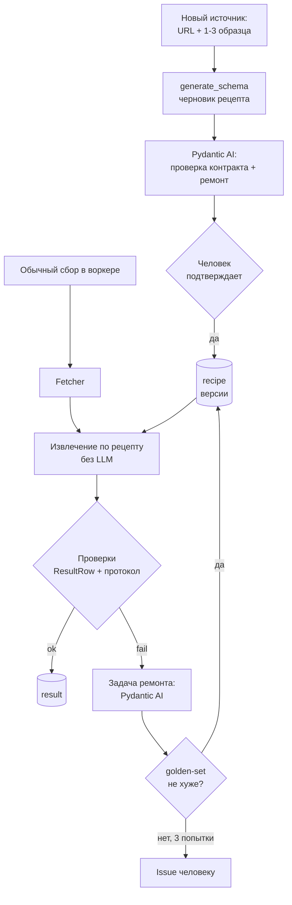

# Спека парсера источников и агента

Как парсер встраивается в сервисы (api, worker, очередь, версии рейтинга) — в [PIPELINE_ARCHITECTURE.md](PIPELINE_ARCHITECTURE.md). Здесь — как устроен сбор одного источника: рецепты, их хранение, агент генерации и ремонта.

Проблема: на каждую площадку пишется отдельный Python-парсер с захардкоженными селекторами. Новый источник — новый файл, смена вёрстки — ручная правка. Цель: подключать источники без нового кода и при этом не платить токенами и временем за каждую страницу.

Пометки: [док] — подтверждено документацией по ссылке; [проверить] — допущение, проверяется в пилоте.

## 1. Главная идея

**LLM — не парсер, а автор и ремонтник рецепта.**

- Рецепт — это данные: CSS-схема или JSON-маппинг, как вытащить строки протокола со страницы источника.
- LLM пишет рецепт **один раз** при подключении источника по 1-3 страницам-образцам.
- Каждый обычный прогон исполняет рецепт детерминированно, без LLM: 0 токенов, скорость обычного парсера.
- Если вёрстка поменялась и проверка данных упала, LLM **чинит** рецепт: получает старый рецепт, ошибки и новый образец.

Так токены тратятся только на подключение и ремонт, а не на каждую из тысяч страниц.

## 2. Какие подходы есть

| Подход | Токены | Скорость | Надёжность | Вывод |
|---|---|---|---|---|
| LLM разбирает каждую страницу | Много, растут с числом страниц | Медленно | Возможны галлюцинации в цифрах (время, место) | Не подходит для тысяч протоколов |
| **LLM пишет рецепт один раз, дальше без LLM** | Только при подключении и ремонте | Как обычный парсер | Высокая; дрейф вёрстки ловится проверками | **Выбран** |
| LLM пишет Python-код парсера | Как у рецепта | Как обычный парсер | Гибче, но нужен запуск чужого кода в песочнице | Сложнее и опаснее, не нужно |
| Браузерный агент (browser-use, Skyvern) на каждый прогон | Очень много | Очень медленно | Нестабильно | Только для разведки, не для сбора |
| Найти JSON API сайта один раз, дальше прямые запросы | Почти ноль | Максимальная | Высокая, пока API не меняют | Для SPA-площадок |

Подтверждение идеи: в Crawl4AI это штатный режим — `generate_schema` один раз генерирует CSS-схему через LLM, дальше `JsonCssExtractionStrategy` извлекает данные без LLM [док](https://docs.crawl4ai.com/extraction/no-llm-strategies/). В исследованиях тот же подход называют wrapper induction с LLM-ремонтом ([AutoScraper](https://arxiv.org/abs/2404.12753), [VLDB 2025](https://www.vldb.org/2025/Workshops/VLDB-Workshops-2025/PhD/PhD25_4.pdf)).

## 3. Три класса источников

| Класс | Примеры | Рецепт | Нужен ли LLM |
|---|---|---|---|
| A. Открытый JSON API | russiarunning/timerman, myrunstats | `ApiRecipe`: эндпоинт + путь к строкам + маппинг полей | Только чтобы написать маппинг (1-3 тыс. токенов) |
| B. HTML или JSON внутри HTML | runc, grom, probeg, results.zone | CSS-схема Crawl4AI | Генерация схемы и ремонт |
| C. PDF и сканы | протоколы биатлона | Docling/OCR + маппинг колонок | Позже, вне первой версии |

## 4. Стек

| Задача | Инструмент | Почему |
|---|---|---|
| Загрузка страниц | свой `httpx`-Fetcher из воркера | Лимиты на домен, повторы, кэш; браузер не нужен для классов A и B |
| Формат рецепта класса B и извлечение | **Crawl4AI** `JsonCssExtractionStrategy` | Готовая схема: `baseSelector`, поля `text`/`attribute`/`nested_list`/`regex`, `transform` [док](https://docs.crawl4ai.com/extraction/no-llm-strategies/) |
| Первая версия рецепта класса B | **Crawl4AI** `generate_schema` | Генерирует схему по 1-N образцам, сам проверяет её на образце и дорабатывает селекторы, считает токены (`TokenUsage`) [док](https://docs.crawl4ai.com/extraction/no-llm-strategies/) |
| Проверка по нашему контракту, ремонт, рецепты класса A | **Pydantic AI** | Тип результата — Pydantic-модель; ошибка проверки возвращается модели через `ModelRetry`, модель исправляет; лимит попыток `retries` [док](https://pydantic.dev/docs/ai/overview/) |
| Контракт данных | Pydantic v2: `ResultRow` + проверки протокола | Один контракт для всех источников |
| LLM | Провайдер из настроек, по умолчанию GigaChat | Модель меняется строкой в `Settings` без правки кода |

Почему не LangGraph или Agno: у нас не граф из десятков узлов и не команда агентов, а один цикл «сгенерировал → проверил → починил». Pydantic AI делает его минимумом кода и совпадает со стеком FastAPI + Pydantic.

Crawl4AI и Pydantic AI не конкуренты: Crawl4AI отвечает за формат рецепта и извлечение, Pydantic AI — за цикл проверки и ремонта.

### GigaChat

- Нативного провайдера GigaChat в Pydantic AI нет. Путь: OpenAI-совместимый endpoint Сбера или прокси `gpt2giga` + `OpenAIProvider(base_url=...)` [док](https://developers.sber.ru/docs/ru/gigachat/guides/compatible-openai).
- Совместимость с OpenAI «частичная», про JSON Schema документация молчит. Поэтому структурный ответ берём режимом `PromptedOutput` (JSON в тексте + валидация Pydantic), а не через tool calling [проверить].
- Crawl4AI ходит в LLM через `LLMConfig(provider, api_token, base_url)` — тот же OpenAI-совместимый endpoint [док](https://docs.crawl4ai.com/core/browser-crawler-config/).
- Качество GigaChat на генерации CSS-селекторов не проверено. Пилот сравнивает его с одной сильной моделью; провайдер переключается настройкой.

## 5. Как это работает



Правила:

- **Новый источник** всегда подтверждает человек: смотрит 20 строк результата.
- **Ремонт** применяется автоматически, если новая версия рецепта проходит golden-set не хуже старой. Иначе — issue человеку.
- **Один ремонт на источник за раз.** Пока ремонт идёт, остальные страницы этого источника ждут — без этого смена вёрстки на 1000 страниц дала бы 1000 вызовов LLM.
- **Старая версия рецепта не удаляется**: откат — переключить активную версию.
- **Golden-set**: на каждый источник 3-5 сохранённых страниц с эталонным результатом. Для текущих источников эталон — вывод старых парсеров.

## 6. Где и как хранятся источники и рецепты

### Что такое рецепт источника

Рецепт описывает не одну страницу, а **весь обход источника**: как найти соревнования, в них дистанции, а в дистанциях строки протокола. Каждый уровень — это URL-шаблон и способ извлечения (CSS-схема Crawl4AI для HTML или JSON-маппинг для API).

```
events    список соревнований    →  external_id, name, date, url
races     дистанции соревнования →  external_id, name, distance, protocol_url
protocol  строки протокола       →  ResultRow
```

Так навигация, которая сейчас захардкожена в `runc.py`/`grom.py`/`rr_platform.py`, тоже становится данными. При подключении источника агент генерирует каждый уровень отдельно, по образцу страницы этого уровня. Ремонт чинит только упавший уровень.

Укладывается ли навигация всех текущих площадок в три уровня с URL-шаблонами (без логина, POST-форм, бесконечного скролла) — проверить в пилоте [проверить]. Источник, который не укладывается, остаётся на ручном коннекторе с тем же контрактом `ResultRow`.

### Таблицы

Всё лежит в Postgres рядом с остальными данными. Файлов-рецептов в репозитории нет: рецепты меняет воркер (ремонт), а ему нужна запись в БД с версиями.

```sql
CREATE TABLE source (
    id                 integer GENERATED ALWAYS AS IDENTITY PRIMARY KEY,
    name               text NOT NULL UNIQUE,
    base_url           text NOT NULL,
    kind               text NOT NULL CHECK (kind IN ('html', 'api')),
    status             text NOT NULL DEFAULT 'draft'
                       CHECK (status IN ('draft', 'active', 'repairing', 'blocked', 'disabled')),
    schedule_interval  interval NOT NULL DEFAULT '1 day',
    rate_limit         jsonb NOT NULL DEFAULT '{"concurrency": 1, "min_interval_s": 1.0}',
    last_success_at    timestamptz
);

CREATE TABLE recipe (
    id           bigint GENERATED ALWAYS AS IDENTITY PRIMARY KEY,
    source_id    integer NOT NULL REFERENCES source(id),
    version      integer NOT NULL,
    body         jsonb NOT NULL,
    status       text NOT NULL DEFAULT 'draft'
                 CHECK (status IN ('draft', 'active', 'retired', 'rejected')),
    created_by   text NOT NULL CHECK (created_by IN ('llm', 'human')),
    reason       text,
    golden_score double precision,
    tokens_used  integer,
    created_at   timestamptz NOT NULL DEFAULT now(),
    activated_at timestamptz,
    UNIQUE (source_id, version)
);

CREATE UNIQUE INDEX recipe_one_active ON recipe (source_id) WHERE status = 'active';

CREATE TABLE golden_case (
    id         bigint GENERATED ALWAYS AS IDENTITY PRIMARY KEY,
    source_id  integer NOT NULL REFERENCES source(id),
    level      text NOT NULL CHECK (level IN ('events', 'races', 'protocol')),
    url        text NOT NULL,
    html_path  text NOT NULL,
    expected   jsonb NOT NULL,
    created_at timestamptz NOT NULL DEFAULT now()
);

ALTER TABLE result ADD COLUMN recipe_id bigint REFERENCES recipe(id);
```

- `recipe.body` — рецепт целиком, валидируется моделью `SourceRecipe` (раздел 9) при записи и чтении.
- Частичный уникальный индекс гарантирует ровно одну активную версию на источник.
- Сам HTML образцов golden-set лежит файлом в томе кэша (`html_path`), в БД — только путь и эталонный результат.
- `result.recipe_id` показывает, какой версией рецепта получена каждая строка: при ошибке видно, что перепарсить.

### Жизненный цикл версии

```
draft ──(golden-set пройден, человек или авторемонт)──▶ active ──(вышла новая)──▶ retired
  └──(проверки не прошли / человек отклонил)──▶ rejected
```

Активация — одна транзакция: старая `active` → `retired`, новая → `active`. Откат — та же операция в обратную сторону, через админ-эндпоинт.

### Откуда берутся golden-кейсы

- **Текущие источники:** сохранённые страницы из кэша + вывод старых парсеров как эталон.
- **Новый источник:** человек при подтверждении проверяет 20 строк; подтверждённые образцы становятся golden-кейсами.
- **После ручного ремонта:** человек может добавить кейс со страницей, на которой рецепт сломался.

### На что влияет рецепт

| Что | Как |
|---|---|
| Сбор | Воркер берёт `active`-рецепт источника; без него источник не собирается |
| Статус источника | Ремонт идёт → `repairing`, сбор этого источника ждёт; issue человеку без решения → источник остаётся на старой версии |
| Данные | Каждая строка `result` помечена `recipe_id` |
| Повторный сбор | После активации новой версии страницы, упавшие на старой, ставятся в сбор заново |
| Рейтинг | Напрямую не влияет: новые данные попадают в рейтинг через обычный `rebuild` и проверки версии из PIPELINE_ARCHITECTURE |

### Админ-API

| Метод | Что делает |
|---|---|
| `POST /api/v1/sources` | Добавить источник: URL + 1-3 образца → задача генерации рецепта |
| `GET /api/v1/sources/{id}/recipes` | Версии рецепта, статусы, токены, golden_score |
| `POST /api/v1/recipes/{id}/approve` | Человек подтверждает черновик → `active` |
| `POST /api/v1/recipes/{id}/rollback` | Сделать эту версию активной |

## 7. Проверки данных

Проверки ловят и поломку рецепта, и «тихий дрейф», когда селектор работает, но берёт не ту колонку.

- Каждая строка проходит `ResultRow`: ФИО не пустое, время > 0 и в разумном коридоре, пол `M`/`F`, год рождения в диапазоне.
- Место не убывает при сортировке по времени (с допуском на DNF/DSQ и равное время).
- Число строк сходится с «Всего / Финишировало» в шапке протокола, если оно есть.
- Доля пустых полей и медиана времени не отличаются от прошлого успешного прогона больше порога.

## 8. Экономия токенов

1. Рецепт вместо разбора каждой страницы — основная экономия.
2. LLM видит 1-3 образца, а не все страницы: первую и одну из середины, чтобы попались DNF и строки без возраста.
3. Перед отправкой в LLM HTML сжимается: без `script`/`style`/`svg`, шапки и меню, длинная таблица урезается до нескольких строк.
4. Ремонт получает старый рецепт + ошибки + новый образец, а не генерирует с нуля.
5. Лимит попыток: 3 на генерацию, 3 на ремонт; дальше человек.

## 9. Код

### Контракт строки протокола

```python
Seconds = Annotated[float, Field(gt=0, lt=24 * 3600)]


class ResultRow(BaseModel):
    place: int | None = Field(None, ge=1)
    full_name: str = Field(min_length=3)
    gender: Literal["M", "F"] | None = None
    birth_year: int | None = Field(None, ge=1920, le=2026)
    club: str | None = None
    finish_seconds: Seconds | None = None
    status: Literal["finished", "dnf", "dsq", "dns"] = "finished"

    @model_validator(mode="after")
    def finished_has_time(self) -> Self:
        if self.status == "finished" and self.finish_seconds is None:
            raise ValueError("finished без времени")
        return self
```

### Рецепт

```python
class HtmlRecipe(BaseModel):
    kind: Literal["html"] = "html"
    schema_: dict[str, Any] = Field(alias="schema")


class ApiRecipe(BaseModel):
    kind: Literal["api"] = "api"
    endpoint: str
    rows_path: str
    fields: dict[str, str]


PageRecipe = Annotated[HtmlRecipe | ApiRecipe, Field(discriminator="kind")]


class Level(BaseModel):
    url_template: str
    extract: PageRecipe
    next_page: str | None = None


class SourceRecipe(BaseModel):
    events: Level
    races: Level
    protocol: Level
```

`url_template` подставляет значения с уровня выше: `{base_url}/events/{event_id}`, `{protocol_url}`. `next_page` — CSS-селектор или JSON-путь ссылки на следующую страницу пагинации.

`HtmlRecipe.schema` — это схема Crawl4AI как есть:

```json
{
  "name": "protocol",
  "baseSelector": "table.results tbody tr",
  "fields": [
    {"name": "place", "selector": "td:nth-child(1)", "type": "text"},
    {"name": "full_name", "selector": "td.name a", "type": "text"},
    {"name": "finish_time", "selector": "td.time", "type": "text"}
  ]
}
```

### Черновик рецепта через Crawl4AI

```python
QUERY = "Extract each result row: place, full_name, gender, birth_year, club, finish_time, status"


async def draft_html_recipe(samples: list[str], llm: LLMConfig) -> HtmlRecipe:
    usage = TokenUsage()
    schema = await JsonCssExtractionStrategy.agenerate_schema(
        samples[0],
        schema_type="css",
        query=QUERY,
        llm_config=llm,
        usage=usage,
    )
    log.info("recipe_drafted", tokens=usage.total_tokens)
    return HtmlRecipe(schema=schema)
```

`agenerate_schema` — асинхронный вариант `generate_schema` [док]. Передача нескольких образцов описана в разделе «Multi-Sample Schema Generation» документации; точную сигнатуру проверить на установленной версии [проверить].

### Извлечение по рецепту

```python
async def extract(recipe: HtmlRecipe, html: str, crawler: AsyncWebCrawler) -> list[dict[str, Any]]:
    config = CrawlerRunConfig(extraction_strategy=JsonCssExtractionStrategy(recipe.schema_))
    result = await crawler.arun(url=f"raw://{html}", config=config)
    if not result.success:
        raise ExtractionError(result.error_message)
    return json.loads(result.extracted_content)
```

`raw://` — штатный способ передать уже скачанный HTML без сетевого запроса [док](https://docs.crawl4ai.com/extraction/no-llm-strategies/). Поднимает ли `AsyncWebCrawler` браузер в режиме `raw://` — проверить в пилоте; если да, вызывать стратегию извлечения напрямую, без краулера [проверить].

### Агент ремонта на Pydantic AI

```python
@dataclass
class RepairDeps:
    samples: list[str]
    golden: list[GoldenCase]
    crawler: AsyncWebCrawler


repair_agent = Agent(
    model=settings.llm_model,
    deps_type=RepairDeps,
    output_type=PromptedOutput(HtmlRecipe),
    retries=3,
    instructions=(
        "Ты исправляешь CSS-схему Crawl4AI для протокола соревнований. "
        "Используй только селекторы, которые есть в образце. Верни схему целиком."
    ),
)


@repair_agent.output_validator
async def check_recipe(ctx: RunContext[RepairDeps], recipe: HtmlRecipe) -> HtmlRecipe:
    for sample in ctx.deps.samples:
        try:
            rows = [ResultRow.model_validate(normalize(r)) for r in await extract(recipe, sample, ctx.deps.crawler)]
        except (ExtractionError, ValidationError) as exc:
            raise ModelRetry(f"рецепт не работает: {exc}") from exc
        report = check_protocol(rows)
        if not report.ok:
            raise ModelRetry(f"проверки не прошли: {report.model_dump_json()}")
    if not passes_golden(recipe, ctx.deps.golden):
        raise ModelRetry("на golden-set хуже, чем старая версия")
    return recipe


async def repair(old: HtmlRecipe, errors: str, deps: RepairDeps) -> HtmlRecipe:
    prompt = f"Старая схема:\n{old.model_dump_json(by_alias=True)}\n\nОшибки:\n{errors}\n\nОбразец:\n{compress(deps.samples[0])}"
    result = await repair_agent.run(prompt, deps=deps)
    return result.output
```

`output_validator` и есть цикл «проверил → починил»: ошибка уходит модели текстом через `ModelRetry`, модель возвращает новую схему, после `retries` попыток агент сдаётся и открывается issue человеку. Тот же агент с другим промптом доводит черновик от `generate_schema` до прохождения контракта при подключении нового источника.

### Горячий путь в воркере

```python
async def collect_page(source: Source, url: str, ctx: CollectContext) -> None:
    recipe = await ctx.recipes.active(source.id)
    html = await ctx.fetcher.get_text(url)
    try:
        rows = [ResultRow.model_validate(normalize(r)) for r in await extract(recipe, html, ctx.crawler)]
        report = check_protocol(rows)
    except (ExtractionError, ValidationError) as exc:
        await ctx.repairs.request_once(source.id, reason=str(exc), sample=html)
        return
    if not report.ok:
        await ctx.repairs.request_once(source.id, reason=report.model_dump_json(), sample=html)
        return
    await ctx.store.save(source.id, url, rows)
```

`request_once` ставит задачу ремонта в очередь `agent`, только если для источника нет открытого ремонта.

## 10. Пилот

Источники:
- **grom** (JSON внутри HTML) и **runc** (серверный HTML) — сравнение с выводом старых парсеров построчно;
- **один новый** источник (results.zone или probeg) — с нуля, измеряем время подключения;
- **russiarunning** — проверка `ApiRecipe`.

Шаги:
1. Golden-set из сохранённых страниц и вывода старых парсеров.
2. Сгенерировать рецепты для grom и runc без подсказок из старого кода, сравнить построчно.
3. Подключить новый источник, человек проверяет 20 строк.
4. Искусственный дрейф: переименовать класс, поменять порядок колонок — проверить авторемонт.
5. Повторить шаги 2-4 на GigaChat и на одной сильной модели.

Критерии:

| Метрика | Цель |
|---|---|
| Совпадение со старыми парсерами на golden-set | ≥ 99,5% строк, 100% по месту и времени |
| Токены на подключение источника | ≤ 30 тыс. |
| Токены на ремонт | ≤ 15 тыс. |
| Время подключения нового источника с проверкой | ≤ 30 минут |
| Успешные авторемонты на синтетическом дрейфе | ≥ 70% |
| Токены LLM при обычном сборе | 0 |

## 11. Риски

- **GigaChat может не справиться с генерацией селекторов** — провайдер меняется настройкой, пилот покажет.
- **Тихие ошибки** (рецепт берёт не ту колонку) ловят проверки из раздела 7, а не LLM.
- **Crawl4AI быстро меняет API** — фиксировать версию в `uv.lock`, доступ к нему держать в одном модуле `pipeline/sources/extract.py`.
- **Prompt injection со страниц**: содержимое страницы — данные; у агента нет инструментов с побочными эффектами, вывод — только схема под Pydantic-моделью.
- **Anti-bot**: соблюдать лимиты и `robots.txt`; CAPTCHA и гео-блоки не обходить — такой источник помечается `blocked` и уходит человеку.

## 12. Источники

- Crawl4AI: [извлечение без LLM и generate_schema](https://docs.crawl4ai.com/extraction/no-llm-strategies/), [LLMConfig](https://docs.crawl4ai.com/core/browser-crawler-config/)
- Pydantic AI: [обзор](https://pydantic.dev/docs/ai/overview/)
- GigaChat: [OpenAI-совместимость и gpt2giga](https://developers.sber.ru/docs/ru/gigachat/guides/compatible-openai)
- Исследования: [AutoScraper, arXiv 2404.12753](https://arxiv.org/abs/2404.12753), [VLDB 2025: wrapper induction + LLM-ремонт](https://www.vldb.org/2025/Workshops/VLDB-Workshops-2025/PhD/PhD25_4.pdf)
- Кэширование действий браузерного агента: [Stagehand](https://docs.stagehand.dev/v4/best-practices/caching)
