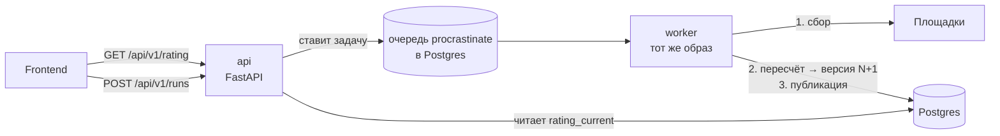

# Архитектура: фоновый сбор и публикация рейтинга

Задача: результаты с нескольких площадок собираются в фоне, сайт всё это время показывает последнюю **готовую** версию рейтинга. Долгий сбор (10+ минут) не блокирует API.

Как устроен сам парсер источника (конфиги, Pydantic AI агент) — в [PARSER_AGENT_SPEC.md](PARSER_AGENT_SPEC.md). Общие правила кода (слои, сессии, Docker) — в [BACKEND_GUIDE.md](BACKEND_GUIDE.md).

## 1. Общая картина



Три правила, на которых всё держится:

1. **Одна база — Postgres.** API, воркер и очередь живут в ней. SQLite нет.
2. **API никогда не ходит на площадки и не считает рейтинг.** Он ставит задачу и читает готовое.
3. **Парсер — не отдельный сервис, а модуль кода.** Его выполняет `worker` — тот же Docker-образ, что и `api`, запущенный другой командой.

| Сервис | Команда | Что делает |
|---|---|---|
| `db` | `postgres:16` | Данные + очередь задач |
| `migrate` | `alembic upgrade head` | Один раз при деплое применяет схему |
| `api` | `uvicorn app.main:app` | HTTP: читает рейтинг, ставит задачи, отдаёт статус |
| `worker` | `procrastinate worker` | Сбор → пересчёт → публикация; расписание |

## 2. Где лежит код

```
app/
  main.py
  modules/
    rating/          router, schemas, service, repository — чтение готового рейтинга
    athletes/
    events/
    runs/            POST/GET /runs — постановка задачи и статус
  pipeline/
    collect.py       сбор по одному источнику: fetch → extract → validate → save
    rebuild.py       пересчёт рейтинга в новую версию
    publish.py       атомарное переключение версии
    fetcher.py       httpx-клиент: лимит на домен, повторы, таймауты
    sources/         конфиги источников и общий экстрактор (PARSER_AGENT_SPEC)
  agent/             Pydantic AI агент (PARSER_AGENT_SPEC)
  worker.py          procrastinate App, задачи и расписание
```

`pipeline/` не импортирует `fastapi`. `modules/runs` не импортирует `pipeline/` — только ставит задачу по имени. Так API и воркер не тянут код друг друга.

## 3. Поток одного обновления

```
1. COLLECT  по задаче на источник, параллельно
            для каждого соревнования: fetch → extract → validate → короткая транзакция записи
            сайт показывает версию N
2. REBUILD  после того, как все источники цикла закончили
            dedup → сопоставление спортсменов → баллы → rating_entry новой версии (status=building)
            проверки: версия не пустая и не меньше 80% предыдущей
3. PUBLISH  одна транзакция: status=ready + переключение rating_current
            сайт показывает версию N+1
4. CLEANUP  храним текущую и 3 последних ready
```

Если шаг 2 упал или не прошёл проверки — версия `failed`, указатель не трогается, сайт работает на старой версии. Ошибка видна в `run.error`.

## 4. Версии рейтинга

Каждый пересчёт пишет полный рейтинг с новым `version_id`. API читает версию, на которую указывает `rating_current`. Переключение — одна короткая транзакция, читатели не блокируются, откат — вернуть указатель.

```sql
CREATE TABLE rating_version (
    id              bigint GENERATED ALWAYS AS IDENTITY PRIMARY KEY,
    status          text NOT NULL DEFAULT 'building' CHECK (status IN ('building', 'ready', 'failed')),
    run_id          bigint REFERENCES run(id),
    athletes_rated  integer,
    error           text,
    created_at      timestamptz NOT NULL DEFAULT now(),
    published_at    timestamptz
);

CREATE TABLE rating_entry (
    version_id    bigint NOT NULL REFERENCES rating_version(id) ON DELETE CASCADE,
    athlete_id    bigint NOT NULL,
    display_name  text NOT NULL,
    gender        text NOT NULL CHECK (gender IN ('M', 'F')),
    birth_year    integer,
    points        double precision NOT NULL,
    starts_count  integer NOT NULL,
    rank          integer NOT NULL,
    rank_gender   integer NOT NULL,
    PRIMARY KEY (version_id, athlete_id)
);
CREATE INDEX rating_entry_gender_rank ON rating_entry (version_id, gender, rank_gender);

CREATE TABLE rating_current (
    singleton   boolean PRIMARY KEY DEFAULT true CHECK (singleton),
    version_id  bigint NOT NULL REFERENCES rating_version(id)
);
```

- Имя, пол и год рождения копируются в `rating_entry`: версия неизменна и читается без JOIN с живыми таблицами.
- Места по полу (`rank_gender`) считаются при сборке версии, а не `COUNT` на каждый запрос.
- Сырые результаты (`result`, `race`) в версии не копируются: они обновляются инкрементально.

Публикация:

```python
async def publish(session: AsyncSession, version_id: int) -> None:
    async with session.begin():
        await session.execute(
            update(RatingVersion)
            .where(RatingVersion.id == version_id, RatingVersion.status == "building")
            .values(status="ready", published_at=func.now())
        )
        await session.execute(
            insert(RatingCurrent)
            .values(singleton=True, version_id=version_id)
            .on_conflict_do_update(index_elements=["singleton"], set_={"version_id": version_id})
        )
```

Чтение — один запрос, `rows` и `total` из одной версии:

```python
async def get_page(self, gender: Gender | None, limit: int) -> RatingPage:
    current = select(RatingCurrent.version_id).scalar_subquery()
    stmt = (
        select(RatingEntry, func.count().over().label("total"))
        .where(RatingEntry.version_id == current)
        .order_by(RatingEntry.rank)
        .limit(limit)
    )
    if gender:
        stmt = stmt.where(RatingEntry.gender == gender)
    ...
```

## 5. Запуски: таблица и API

```sql
CREATE TABLE run (
    id           bigint GENERATED ALWAYS AS IDENTITY PRIMARY KEY,
    kind         text NOT NULL CHECK (kind IN ('collect', 'rebuild', 'full')),
    source_id    integer REFERENCES source(id),
    trigger      text NOT NULL CHECK (trigger IN ('manual', 'schedule')),
    status       text NOT NULL DEFAULT 'queued'
                 CHECK (status IN ('queued', 'running', 'succeeded', 'failed')),
    progress     jsonb NOT NULL DEFAULT '{}',
    stats        jsonb NOT NULL DEFAULT '{}',
    error        text,
    queued_at    timestamptz NOT NULL DEFAULT now(),
    started_at   timestamptz,
    finished_at  timestamptz
);

CREATE UNIQUE INDEX run_one_active_per_source
    ON run (coalesce(source_id, 0), kind)
    WHERE status IN ('queued', 'running');
```

Частичный уникальный индекс — защита от двойного запуска: второй `POST` на тот же источник получает `409`.

| Метод | Ответ |
|---|---|
| `POST /api/v1/runs` `{"kind": "collect", "source": "runc"}` | `202 {"run_id": 17, "status": "queued"}` или `409 {"run_id": 15}` |
| `GET /api/v1/runs/{id}` | `{"status": "running", "progress": {"done": 12, "total": 30}, "error": null}` |
| `GET /api/v1/runs?limit=20` | последние запуски |
| `GET /api/v1/rating` | `{"rows": [...], "total": 1234, "version_id": 42, "published_at": "...", "refreshing": true}` |

`POST /runs` закрыт токеном администратора из окружения. Фронтенд показывает плашку «данные на {published_at}» и индикатор «идёт обновление».

```python
@router.post("", status_code=status.HTTP_202_ACCEPTED, response_model=RunQueued)
async def create_run(body: RunIn, service: RunServiceDep, _: AdminDep) -> RunQueued:
    return await service.enqueue(body)
```

```python
class RunService:
    async def enqueue(self, body: RunIn) -> RunQueued:
        try:
            run = await self.repo.create(kind=body.kind, source=body.source, trigger="manual")
            await self.session.commit()
        except IntegrityError:
            await self.session.rollback()
            raise RunAlreadyActive(await self.repo.active_id(body.source))
        await collect_source.defer_async(run_id=run.id)
        return RunQueued(run_id=run.id, status="queued")
```

## 6. Воркер

```python
app = procrastinate.App(connector=procrastinate.PsycopgConnector(conninfo=settings.database_url))


@app.task(queue="collect", retry=procrastinate.RetryStrategy(max_attempts=3, wait=60))
async def collect_source(run_id: int) -> None:
    await pipeline.collect.run(run_id)


@app.task(queue="rebuild")
async def rebuild_rating(run_id: int) -> None:
    version_id = await pipeline.rebuild.run(run_id)
    await pipeline.publish.run(version_id)


@app.task(queue="agent")
async def repair_recipe(source_id: int) -> None:
    await agent.repair.run(source_id)


async def request_repair(source_id: int) -> None:
    with contextlib.suppress(procrastinate.exceptions.AlreadyEnqueued):
        await repair_recipe.configure(queueing_lock=f"repair-{source_id}").defer_async(source_id=source_id)


@app.periodic(cron="0 * * * *")
@app.task(queue="collect", queueing_lock="schedule")
async def schedule_tick(timestamp: int) -> None:
    await pipeline.schedule.enqueue_due_sources()
```

- Источники собираются параллельно: каждый — отдельная задача, воркер запущен с `--concurrency 4`.
- Внутри источника соревнования идут через `asyncio.Semaphore(4)`.
- `rebuild` выполняется в одном экземпляре (`queue=rebuild`, concurrency 1) и ставится, когда все `collect` текущего цикла закончились.
- Ремонт рецепта (Pydantic AI) — задача очереди `agent`, один на источник за раз. Сбор источника ждёт его, остальные источники идут дальше.
- Расписание — `periodic` в том же воркере, отдельный планировщик не нужен. Интервал хранится в `source.schedule_interval`.
- Задачи идемпотентны: результаты дистанции перезаписываются целиком, повтор задачи безопасен.

### Fetcher

Один `httpx.AsyncClient` на процесс воркера, лимит запросов на домен, повторы на сетевые ошибки и 429/5xx с паузой (`Retry-After`, если есть), таймаут на каждый запрос.

```python
class Fetcher:
    def __init__(self, client: httpx.AsyncClient, limits: dict[str, DomainLimit]) -> None:
        self._client = client
        self._limiters = {host: DomainLimiter(limit) for host, limit in limits.items()}

    async def get_text(self, url: str) -> str:
        async for attempt in retrying(max_attempts=4, retry_on=RETRYABLE):
            with attempt:
                async with self._limiter(url).slot():
                    response = await self._client.get(url, timeout=30)
                response.raise_for_status()
                return response.text
```

### Короткие транзакции

Сеть и разбор идут **до** открытия транзакции. Транзакция — только вокруг записи одной дистанции.

```python
async def save_race(session_factory: async_sessionmaker, race: RaceIn, rows: list[ResultRow]) -> None:
    async with session_factory() as session, session.begin():
        race_id = await races.upsert(session, race)
        await session.execute(select(Race.id).where(Race.id == race_id).with_for_update())
        await session.execute(delete(Result).where(Result.race_id == race_id))
        await session.execute(insert(Result), [row.model_dump() | {"race_id": race_id} for row in rows])
```

`FOR UPDATE` на дистанции не даёт двум задачам одновременно перезаписать одну дистанцию и наплодить дубли.

## 7. docker-compose

Dockerfile — по BACKEND_GUIDE, раздел 10. Один образ на `migrate`, `api`, `worker`.

```yaml
services:
  db:
    image: postgres:16
    environment:
      POSTGRES_DB: rating
      POSTGRES_USER: rating
      POSTGRES_PASSWORD: ${POSTGRES_PASSWORD:?задайте POSTGRES_PASSWORD}
    volumes: [pgdata:/var/lib/postgresql/data]
    healthcheck:
      test: ["CMD-SHELL", "pg_isready -U rating -d rating"]
      interval: 5s
      retries: 10
    restart: unless-stopped

  migrate:
    build: .
    image: rating/app
    command: ["alembic", "upgrade", "head"]
    env_file: [.env]
    depends_on:
      db: {condition: service_healthy}
    restart: "no"

  api:
    image: rating/app
    command: ["uvicorn", "app.main:app", "--host", "0.0.0.0", "--port", "8000"]
    env_file: [.env]
    ports: ["127.0.0.1:8000:8000"]
    depends_on:
      migrate: {condition: service_completed_successfully}
    restart: unless-stopped

  worker:
    image: rating/app
    command: ["procrastinate", "--app=app.worker.app", "worker", "--concurrency", "4"]
    env_file: [.env]
    depends_on:
      migrate: {condition: service_completed_successfully}
    restart: unless-stopped

volumes:
  pgdata:
```

Схема procrastinate применяется той же Alembic-миграцией, что и таблицы приложения.

## 8. План перехода

Каждая итерация оставляет рабочее состояние. S — до дня, M — 2-3 дня, L — 4-6 дней.

| # | Итерация | Результат | Сложность |
|---|---|---|---|
| 0 | API на Postgres: спортсмены и рейтинг из PG, SQLite удалить | Сайт читает те же данные, что пишет парсер | L |
| 1 | Версии рейтинга: таблицы, `rebuild` + `publish` (пока из CLI), убрать пересчёт из `lifespan` | Сайт показывает готовую версию, публикация атомарна | M |
| 2 | Воркер: procrastinate, таблица `run`, `POST/GET /runs`, старый парсер внутри задачи, транзакция на дистанцию | Сбор по кнопке, API не блокируется, двойной запуск невозможен | M |
| 3 | Цепочка и расписание: collect → rebuild → publish автоматически, плашка на фронте | Сайт обновляется сам | M |
| 4 | Источники на конфигах и агент (PARSER_AGENT_SPEC) | Новый источник без нового Python-файла | L |
| 5 | Async-fetcher и параллельный сбор | Сбор в разы быстрее | M |

Итерации 0-2 решают исходную задачу: «обновлять в фоне и показывать последнюю готовую версию». Биатлон (PDF/OCR) подключается после итерации 4.
